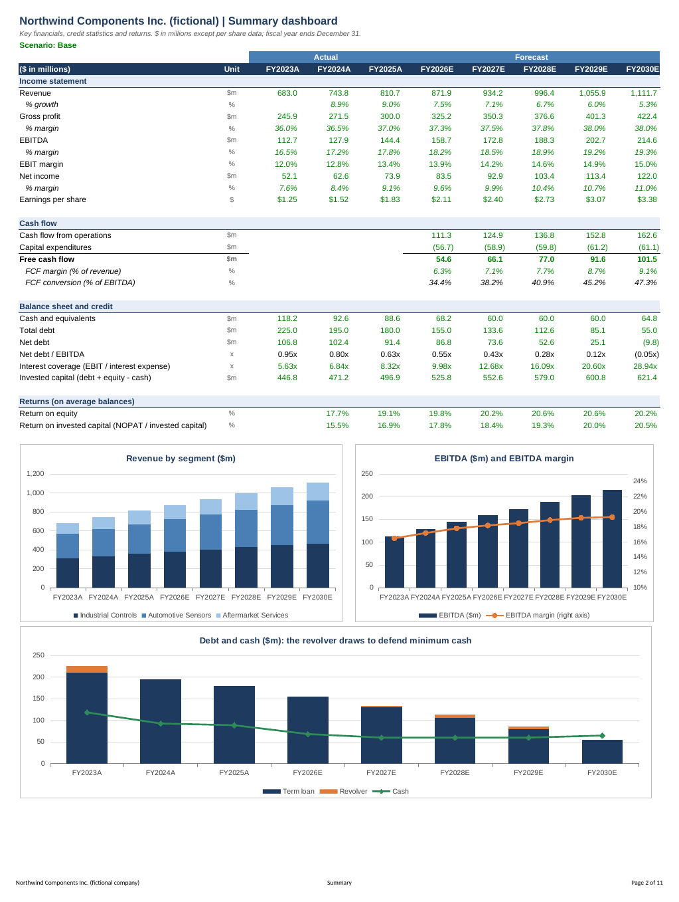
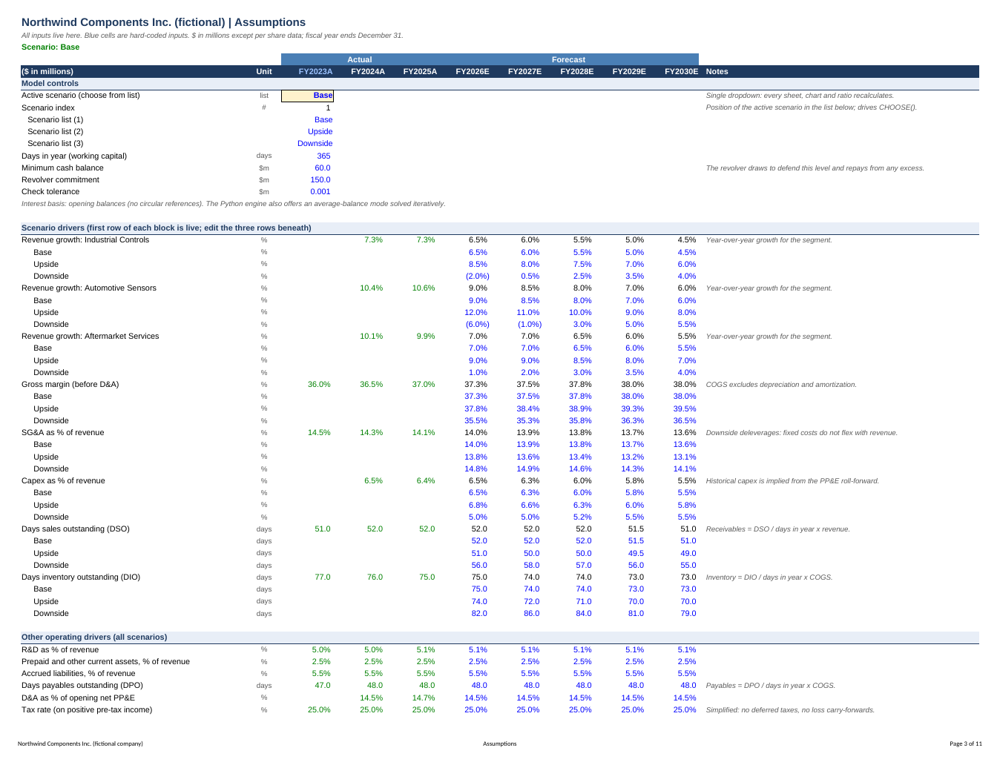

# three-statement-model

[](https://github.com/adhamkarim4815/three-statement-model/actions/workflows/ci.yml)


An integrated three-statement forecasting model (income statement, balance sheet, cash flow statement) for a **fictional** industrial manufacturer, Northwind Components Inc., delivered two ways: a small Python engine with a CLI, and a banker-formatted Excel workbook in which every statement, schedule, check and ratio is a **live Excel formula** driven by one Assumptions sheet and one scenario dropdown (Base, Upside, Downside). The workbook has no circular references, uses the standard blue/black/green colour code, and ships with an automated test that recalculates it in headless LibreOffice and reconciles every line item to the Python engine in all three scenarios.



*The Summary sheet (Base scenario): margins, FCF, leverage, coverage, ROE and ROIC, plus three native Excel charts. Rendered from `examples/northwind_model.xlsx` with LibreOffice.*

## Highlights

| | |
|---|---|
| **Company** | Northwind Components Inc. (fictional): 3 segments, 3 actual years (FY2023A to FY2025A), 5 forecast years (FY2026E to FY2030E) |
| **Drivers** | Segment revenue growth, gross margin, SG&A and R&D as % of revenue, capex as % of revenue, D&A through a PP&E roll-forward, DSO / DIO / DPO, tax, interest rates, dividends, buybacks, optional stock issuance |
| **Debt** | Term loan with mandatory amortization plus a revolver that auto-draws to defend minimum cash, repays from excess cash, never goes negative and respects its commitment |
| **Interest** | Excel: opening balances (no circularity). Python: `opening` or `average` (solved iteratively) |
| **Scenarios** | One dropdown cell in Excel (`CHOOSE` on a `MATCH` index) and `--scenario` on the CLI |
| **Checks** | Balance sheet balances, cash ties to the cash flow statement, retained earnings, debt, PP&E and equity roll-forwards, minimum cash, revolver limit |
| **Validation** | 100+ unit tests plus an Excel-vs-Python reconciliation of about 1,070 formula cells per scenario (3,200+ in total) after a LibreOffice recalculation |

## Quick start

```bash
git clone https://github.com/adhamkarim4815/three-statement-model
cd three-statement-model
pip install -e .                      # runtime dependency: xlsxwriter only

three-statement build --scenario base --out model.xlsx     # Excel workbook with live formulas
three-statement run --scenario downside                    # prints the three statements
three-statement run --scenario base --interest average     # average-balance interest (iterative)
three-statement compare                                    # scenarios side by side
three-statement sensitivity --scenario base                # growth vs gross margin grids
three-statement validate                                   # recalc in LibreOffice and reconcile
```

You do not need to run anything to look at the model: open [`examples/northwind_model.xlsx`](examples/northwind_model.xlsx) (Base scenario selected, cached values included). Change the yellow cell on the Assumptions sheet to switch scenario.

Sample output of `three-statement compare`:

```
                                          Base      Upside    Downside
----------------------------------------------------------------------
FY2030E revenue ($m)                   1,111.7     1,223.3       881.1
FY2030E EBITDA ($m)                      214.6       260.6       152.4
FY2030E EBITDA margin                    19.3%       21.3%       17.3%
FY2030E net income ($m)                  122.0       155.0        79.3
FY2030E free cash flow ($m)              101.5       125.1        69.2
FY2030E net debt / EBITDA              (0.05x)     (0.20x)       0.31x
Peak revolver balance ($m)                 7.6         0.0        52.6
Cumulative FCF, 5 years ($m)             390.8       462.7       276.6
```

In the Downside case revenue dips in FY2026E, margins compress and working capital absorbs cash, so the revolver draws to hold the $60m minimum cash balance and grows to $52.6m. In the Base case it makes a small draw in FY2027E to FY2029E and is repaid by FY2030E. In the Upside case it is never used.

## The Excel workbook

| Sheet | What it does |
|---|---|
| **Cover** | Purpose, how to use, sheet guide with hyperlinks, colour code, conventions, limitations |
| **Summary** | Dashboard: margins, EPS, FCF, net debt / EBITDA, interest coverage, ROE, ROIC, three charts |
| **Assumptions** | The scenario dropdown and every driver. Each scenario driver has a live row (`CHOOSE`) above Base, Upside and Downside input rows. Historical ratios are shown beside the forecast for context |
| **Income Statement**, **Balance Sheet**, **Cash Flow** | The three statements, years across, same column = same year on every sheet |
| **Schedules** | PP&E roll-forward, working capital (days), term loan, cash before revolver, revolver, interest, retained earnings, paid-in capital and treasury stock, share count |
| **Checks** | Eleven integrity tests with TRUE/FALSE status and an overall flag (named range `Model_Checks_OK`) |
| **Sensitivity** | Python-generated grids (static values, clearly labelled) of FY2030E EBITDA and FCF |



**Formatting conventions.** Blue font: hard-coded inputs and historical data. Black: formulas that calculate from the same sheet. Green: formulas that pull from another sheet or from a named input. Years are column headers (`FY2026E`), panes are frozen at the first data cell, gridlines are hidden, every sheet is set to print landscape (Summary: portrait) fit to one page wide with repeating headers, and units are stated on every sheet. Named ranges: `Scenario`, `Scenario_Idx`, `Days_In_Year`, `Min_Cash`, `Revolver_Limit`, `Tolerance`, `Model_Checks_OK`.

## Methodology

All amounts are in $ millions. `t` is a forecast year and `t-1` the prior year-end. The Python engine (`engine.py`) and the Excel formulas (`layout.py`) implement exactly the same equations.

### How the statements link

```
Assumptions --> Income statement --> Net income --------------------------+
                      |                                                   v
                      +--> D&A --> PP&E schedule              Cash flow statement --> Ending cash
                                                                  ^   ^   ^                 |
Balance sheet (t-1) --> Working capital schedule ------ change in |   |   | financing       v
                                                           NWC ----+   |   +-- debt schedule --> Balance sheet (t)
Capex % revenue --> PP&E schedule ---- capex -------- investing -------+
```

* **Income statement.** Segment revenue grows at the scenario growth rate. `COGS = revenue x (1 - gross margin)` (COGS excludes D&A). `SG&A` and `R&D` are percentages of revenue. `EBITDA = gross profit - SG&A - R&D`, `EBIT = EBITDA - D&A`, `pre-tax income = EBIT - interest expense + interest income`, `tax = max(0, pre-tax income) x tax rate`.
* **PP&E and D&A.** `capex = capex % x revenue`, `D&A = D&A rate x opening net PP&E`, `closing PP&E = opening + capex - D&A`.
* **Working capital (days).** `AR = DSO / 365 x revenue`, `inventory = DIO / 365 x COGS`, `AP = DPO / 365 x COGS`. Prepaids and accrued liabilities are percentages of revenue. The cash flow statement takes each balance sheet change with the right sign.
* **Cash flow statement.** `CFO = net income + D&A - increase in NWC`. `CFI = -capex`. `CFF = -term loan amortization + revolver draw/(repayment) + stock issuance - dividends - buybacks`. Ending cash feeds the balance sheet. `FCF = CFO - capex`.
* **Equity.** `retained earnings = prior + net income - dividends`, with `dividends = payout ratio x max(0, net income)`. Buybacks reduce treasury stock, issuance increases paid-in capital, and both move the share count at the assumed average price (EPS uses average shares).
* **Balance sheet.** Goodwill and other long-term liabilities are held flat. Every other line comes from a schedule, so the balance check is a genuine test rather than a plug.

### The revolver

The term loan amortizes by the mandatory amount (never below zero). The revolver is the balancing facility:

```
cash before revolver = opening cash + CFO + CFI - amortization + issuance - dividends - buybacks
revolver change      = MAX( -opening revolver ,
                            MIN( minimum cash - cash before revolver ,
                                 commitment - opening revolver ) )
closing cash         = cash before revolver + revolver change
```

If cash before the revolver is below the minimum, the shortfall is drawn (up to the commitment). If it is above, the excess repays the revolver (never more than the opening balance, so it cannot go negative). The same single formula appears in `Schedules` in Excel and in `engine.py`.

### Interest and circularity

Interest on a facility depends on its balance, but the closing balance depends on cash flow, which depends on net income, which depends on interest. That loop is the classic model circularity.

* **`opening` basis (Excel, and the Python default).** Interest = rate x opening balance. The loop is cut because opening balances are last year's results, so no circular reference exists, Excel never needs iterative calculation, and the file is robust to hand edits. The trade-off is a small timing bias: debt repaid during the year still accrues interest for the full year, and cash generated earns nothing until next year.
* **`average` basis (Python only).** Interest = rate x average of opening and closing balance. Each forecast year is solved by fixed-point iteration: guess the closing revolver and cash, compute interest, net income and cash flow, recompute the closing balances, and repeat until the change falls below `1e-10`. The map is a strong contraction (each pass scales the error by roughly `rate x (1 - tax) / 2`, about 3 percent), so it converges in 6 to 8 passes; a `RuntimeError` is raised if it ever fails to converge. Average interest is more accurate for a year-long accrual but, in Excel, would require enabling iterative calculation with the usual fragility. In the Base case it lifts FY2026E net income by about $0.4m versus the opening basis.

```
three-statement run --scenario base --interest average
```

### Ratios

`ROE = net income / average equity`. `ROIC = EBIT x (1 - effective tax rate) / average invested capital`, with invested capital `= debt + equity - cash`. `Net debt / EBITDA`. `Interest coverage = EBIT / interest expense`. `FCF margin` and `FCF conversion (% of EBITDA)`.

### Sensitivity

`sensitivity.py` shifts every segment's growth rate (in every forecast year) and the gross margin by -2 to +2 percentage points and re-runs the **full** integrated model for each of the 25 cells (so working capital, interest and the revolver all respond). The result is written to the Sensitivity sheet as values under a banner stating that it is Python-generated and static, because it cannot respond to the dropdown. The centre cell equals the Summary sheet for the scenario selected at build time and is asserted in the tests.

## Validation

Passing unit tests on the Python engine would say nothing about the spreadsheet a recruiter opens, so the workbook itself is tested.

1. `tests/test_reconciliation.py` builds the workbook, re-saves it through `openpyxl` (which discards every cached formula result), selects each scenario through the real dropdown cell, and recalculates it with `soffice --headless --convert-to xlsx` using a profile that forces recalculation on load.
2. The recalculated file is read with `openpyxl(data_only=True)`. Every worksheet row that has an engine counterpart (about 150 rows: revenue, EBITDA, net income, cash, total assets, total liabilities plus equity, revolver and term loan balances, FCF, ratios, schedules and the driver rows themselves) is compared cell by cell with the Python engine. Tolerance: 1e-6 relative; the observed maximum difference is about 5e-12. About 1,070 formula cells are compared per scenario, 3,200+ in total.
3. All check cells must be zero and every status flag and the overall flag must read TRUE.
4. What-if tests edit blue inputs in the workbook (buybacks, minimum cash), recalculate, and compare with the engine run on the same inputs. A second what-if pushes the revolver to its commitment and confirms the Checks sheet **flags** it (minimum cash can no longer be defended) while Excel still equals the engine.

Run it yourself with `three-statement validate` or `python -m pytest`. The test is **skipped automatically (and reported as skipped, not passed) if LibreOffice is not installed**; CI installs `libreoffice-calc` with apt so it always runs there. Further structural tests (no LibreOffice needed) assert that forecast columns contain only formulas, hard-coded numbers are blue, cross-sheet formulas are green, panes are frozen, gridlines hidden, the dropdown is a list validation, three charts exist, and that the formula graph has **no circular references**.

## Project layout

```
three-statement-model/
|-- src/three_statement/
|   |-- inputs.py        typed input containers and validation
|   |-- northwind.py     the fictional company's history and scenario drivers
|   |-- engine.py        integrated forecast: opening and average interest, revolver
|   |-- sensitivity.py   two-way growth vs gross margin re-runs
|   |-- layout.py        declarative row specs: every Excel formula, one row at a time
|   |-- excel.py         workbook writer: formats, charts, names, validation, cover
|   |-- validate.py      LibreOffice recalculation and Excel-vs-Python reconciliation
|   |-- report.py        text, JSON and CSV output
|   `-- cli.py           three-statement build | run | compare | sensitivity | validate
|-- tests/               pytest suite (engine, inputs, CLI, workbook structure, reconciliation)
|-- examples/northwind_model.xlsx   generated workbook, Base scenario
|-- docs/                screenshots rendered from the workbook
|-- scripts/render_docs.py          regenerates the example workbook and screenshots
`-- .github/workflows/ci.yml        ruff + pytest on Python 3.10 to 3.13, with LibreOffice
```

## Development

```bash
pip install -e ".[dev]"
ruff check . && ruff format --check .
python -m pytest              # add -rs to see whether the LibreOffice test ran or was skipped
python scripts/render_docs.py # needs LibreOffice and poppler-utils
```

## Limitations

This is a demonstration model, deliberately simplified:

* **Fictional company.** Northwind Components Inc. and all of its numbers are invented for illustration; they say nothing about any real business.
* **Simplified taxes.** One flat rate on positive pre-tax income. No deferred taxes, no loss carry-forwards, no tax shield timing differences, no interest-deductibility limits.
* **No leases** (IFRS 16 / ASC 842), no pensions, no minority interests, no FX, no acquisitions or disposals.
* **Held-flat items.** Goodwill and intangibles (no amortization or impairment) and other long-term liabilities are constant.
* **One term loan and one revolver.** No cash sweep, no commitment fees, no floating-rate curve, no refinancing. The term loan has no current-portion split.
* **Excel interest uses opening balances**; average-balance interest is available in Python only (see above).
* **No historical cash flow statement.** The model starts from three balance sheets; historical flows such as capex and dividends are shown only as implied figures on the schedules.
* **Static sensitivity.** The Sensitivity sheet does not respond to the dropdown (by design, and labelled as such).
* **Tested in LibreOffice**, not in desktop Excel. The formulas use only long-standing functions (`CHOOSE`, `MATCH`, `SUM`, `MIN`, `MAX`, `IF`, `ROUND`, `AVERAGE`, `SUMPRODUCT`, `ABS`, `AND`).

## License

MIT. See [LICENSE](LICENSE). Copyright (c) 2026 Adham Karim.

Built by Adham Karim, Rotman Commerce, University of Toronto.
